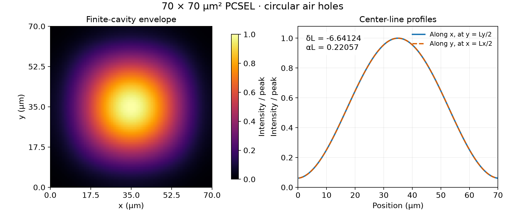

# 3D-CWT

Three-dimensional coupled-wave calculations for square-lattice photonic-crystal
surface-emitting lasers (PCSELs). The Python package calculates the vertical
waveguide mode, the four-wave coupling matrix, and finite-cavity modes on a
staggered grid.

The current optical solver uses NumPy and SciPy.
The original code and its version notes are retained below.

## Example: a 70 µm square cavity

This example uses the circular-hole (CC) structure from Chapter 4 of
[Yong Liang's doctoral thesis](https://doi.org/10.14989/doctor.k18283),
Table 4.1: a 295 nm square lattice, 16% air filling fraction, and a
70 × 70 µm² cavity. The figure shows a calculated single-lobed mode and its
center-line intensity profiles.



The plotted quantity is the slowly varying envelope
`|Rx|² + |Sx|² + |Ry|² + |Sy|²`, divided by its peak. The numerical results,
layer stack, and refinement checks are in the
[70 µm example notes](docs/examples/liang-70um.md).

## Install and run

Run these commands from the repository root.
Python 3.10 or later is required. The `plot` extra installs Matplotlib for the
figure; the calculation itself only needs NumPy and SciPy.

```bash
python -m pip install -e ".[plot]"
python examples/liang_70um.py --N 96 --D 32 --q 64 --output results/liang-70um
python examples/plot_liang_70um.py results/liang-70um
```

The first script writes `summary.json`, `modes.csv`, and `fields.npz`. The second
writes `selected_mode.png`. Choose a new output directory for each calculation;
the solver refuses to overwrite an existing result.

For a quicker first run, use the lower-order defaults:

```bash
python examples/liang_70um.py --output results/liang-70um-quick
```

`--N` is the number of envelope-grid cells per side, `--D` is the auxiliary
Fourier cutoff, and `--q` is the vertical integration order. They control
different numerical errors. The quick run and the plotted run use the same
physical structure.

## Use the calculation from Python

The example exposes the calculation as a function. Run this from the repository
root after installation:

```python
from examples.liang_70um import run_case

case = run_case(N=96, D=32, q=64)
mode = case.modes[0]

print("delta L:", mode.delta * 70)
print("alpha L:", mode.alpha * 70)
print("eigenpair residual:", mode.residual)

intensity = mode.intensity       # shape: (Ny, Nx)
Rx = mode.centers.Rx             # complex envelope at cell centers
C = case.coupling.C              # 4 x 4 coupling matrix, in µm^-1
A, B = case.pencil.A, case.pencil.B
```

`run_case` returns the waveguide reference, coupling matrix, sparse pencil,
eigenpairs, reconstructed fields, and a summary dictionary. Pass `output=...`
to save them. To build a different structure or reuse a coupling matrix, follow
the [complete Python API example](docs/api.md).

The default search targets one mode near the lowest-frequency periodic band
edge. `--k` and `--sigma` select a larger set or a different part of the
spectrum; one search is not a survey of all competing modes. Eigenvalues are
`delta + 1j*alpha`, where `alpha` is an amplitude-loss coefficient. Power loss
is `2*alpha`.

## Documentation

- [Running examples and reading the output](docs/usage.md)
- [Python interfaces and a complete custom calculation](docs/api.md)
- [70 µm structure, results, and numerical checks](docs/examples/liang-70um.md)
- [Model conventions and earlier literature checks](docs/literature_validation.md)
- [Numerical tests](docs/validation.md) and [performance measurements](docs/performance.md)
- [Publishing releases to PyPI](docs/publishing.md)

The current model covers lossless scalar TE waves on a square lattice. The
70 µm calculation uses a layered outgoing Green function and halfspace
claddings, so it is a calculation with the thesis structure rather than an
exact reproduction of the thesis curves. Carrier transport and above-threshold
laser dynamics are not included in the new package.

To run the tests:

```bash
python -m pip install -e ".[dev,plot]"
python -m pytest -q
```

---

## Previous versions (v2)

# 3D-CWT
 Three Dimension Coupled Wave Theory

# Requirements
- Python 3.12 (my environment)
    - numpy=1.26.4
    - scipy=1.14.0
    - matplotlib
    - mph
    - dill
- Comsol Multiphysics
## Installation
```bash
conda env create -f environment.yml
```

# TODO
- [x] Add support for titled photonic crystal
- [x] Add support for finite size photonic crystal
- [ ] Add find_beta0 and find_k0 to class TMM
- [ ] Pure python implementation

# Release Notes
## Latest - Version 2.0.0
 - Organize the code.
## Version 1.3.0
 - Use high accuracy Green's function.
## Version 1.2.0
 - Consider the symmetry of the fourier coefficients, so that the calculation of the fourier coefficients is faster.
## Version 1.0.0
 - Add support for finite size photonic crystal. Powered by [Comsol Multiphysics](https://www.comsol.com/).
## Version 0.4.1
 - Encapsulated into a function.
## Version 0.4.0
 - Add support for titled photonic crystal.
 - Add comsol semiconductor simulation.
## Version 0.3.0
 - Turn back to Python as numerical computing environment.
## Version 0.2.0
 - Use Matlab as numerical computing environment.

# Citing 3D-CWT
If you use this code in your research, please cite the following papers, this will help me a lot.  
In BibTeX format:  
```bibtex
@article{huang_Efficient_2026,
  title = {Towards Efficient {{PCSEL}} Design: A Fully {{AI-driven}} Approach},
  shorttitle = {Towards Efficient {{PCSEL}} Design},
  author = {Huang, Hai and Xu, Ziteng and Xin, Qi and Zhang, Zhaoyu},
  journal = {Chinese Optics Letters},
  volume = {24},
  number = {4},
  pages = {043602},
  year = 2026,
  doi = {10.3788/COL202624.043602},
  langid = {english}
}

@article{huang_Unveiling_2025,
  title = {Unveiling the Potential of Photonic Crystal Surface Emitting Lasers: A Concise Review},
  shorttitle = {Unveiling the Potential of Photonic Crystal Surface Emitting Lasers},
  author = {Huang, Hai and Yang, Chuanyi and Li, Hui and Zhang, Zhaoyu},
  year = 2025,
  month = apr,
  journal = {Semiconductor Science and Technology},
  volume = {40},
  number = {4},
  pages = {43001},
  publisher = {IOP Publishing},
  issn = {0268-1242, 1361-6641},
  doi = {10.1088/1361-6641/adb7fd},
  langid = {english}
}
```
or in following IEEE format:  
[1] H. Huang, C. Yang, H. Li, and Z. Zhang, ‘Unveiling the potential of photonic crystal surface emitting lasers: a concise review’, Semicond. Sci. Technol., vol. 40, no. 4, p. 43001, Apr. 2025, doi: 10.1088/1361-6641/adb7fd.  
[2] H. Huang, Z. Xu, Q. Xin, and Z. Zhang, ‘Towards efficient PCSEL design: a fully AI-driven approach’, Chinese Optics Letters, vol. 24, no. 4, Art. no. 043602, 2026, doi: 10.3788/COL202624.043602.


