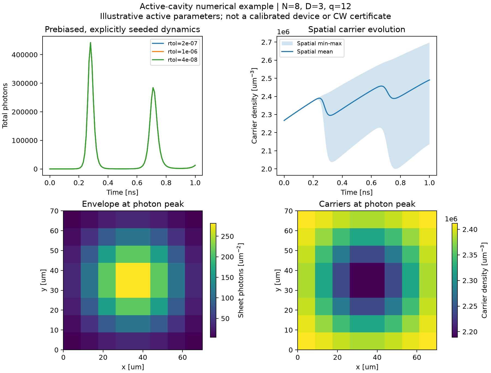
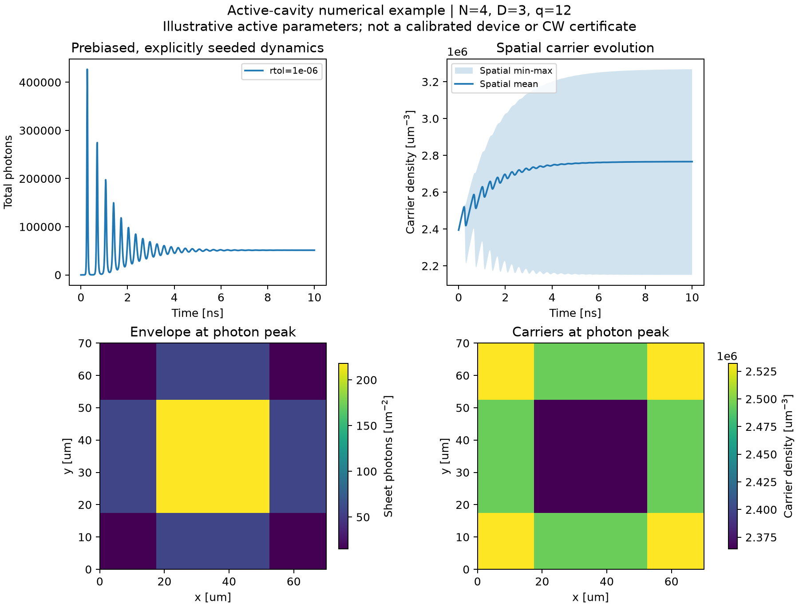

# Active-cavity implementation validation

This records the first local development implementation of `cwt3d.active`. It does **not** change the published `cwt3d 1.3.1` release. The original 16 passive-core Python files remain unchanged. See [model, normalization and API scope](../../active-cavity.md).

## Implementation gates

- The full four-wave spatial pencil is reused, including the staggered mass matrix and exact incoming-boundary elimination. No fixed-passive-mode projection is used in the time solver.
- The passive frequency/decay limit, signed uniform gain/index shifts and the single-mode uniform threshold identity are tested independently.
- Carrier-only injection/recombination, no-flux diffusion conservation, negative-gain absorption and stimulated photon/carrier bookkeeping are tested.
- Nonlinear Jacobian sparsity is checked against finite differences, including mass-solve nonlocality and saturation-induced cross-wave dependencies.
- State/material/result snapshots are checked against array-data and array-header mutation. Solver failure, nonfinite output, output storage and Jacobian structure limits fail explicitly. No density clipping or repeated field normalization is used.
- Physical `CouplingResult.k0` must match the active reference exactly after float conversion. The `6 -> 600` frequency mismatch identified by independent physical review is now rejected; numeric-C input retains caller-declared frequency semantics.

## Real installation tests

The actual source distribution was built first, followed by its wheel. `twine check --strict` passed. All 23 Python files in the wheel matched the checkout byte-for-byte. Tests were run from outside the repository against installed wheels, with isolated Python imports and the extracted source-distribution tests.

| Python | NumPy | SciPy | Full suite |
|---|---|---|---|
| 3.13.14 | 2.5.4 | 1.18.1 | 827 passed |
| 3.10.20 | 1.24.4 | 1.10.1 | 827 passed |

An earlier pre-plot-fix compatibility run also passed817 tests on Python3.10.20 with NumPy2.2.6/SciPy1.15.3. The final suite adds ten plotting regressions: zero-reference/zero-difference metrics equal zero; a nonzero difference against a zero reference is represented by an undefined normalized value plus an explicit absolute error. Strict JSON validation runs before output files are created.

The low-dependency environment also uses Matplotlib3.6.3. Warnings in these completed runs were dependency deprecations, including deliberate array-header mutation tests. A separate earlier run showed an intermittent SciPy BDF history-buffer warning: a controlled probe reproduces `invalid subtract` by placing a signaling NaN only in BDF's initially unused higher-order history, while retaining correct finite output. No broad invalid-arithmetic suppression was added.

## Actual nonlinear trajectories

All cases use the actual Liang chapter4 passive stack, period0.295um, 70um square domain, circle-hole fill fraction0.16, D3/q12/F32, the prepared Green backend and the default reciprocity setting. Active parameters are **illustrative, not calibrated to that device**. Initial carriers are uniformly prebiased, with one explicit seed photon and a pump ratio1.5 relative to the selected mode's uniform weak-field reference. No noise or thermal dynamics is included.



Three N8 runs share physical inputs, initialization and source fingerprints. Relative tolerances are 1e-6,2e-7,4e-8; maximum steps are0.01,0.005,0.0025ns. Absolute field and carrier tolerances remain1e-10 and1e-3. Against the tightest run, the maximum time-sampled differences divided by the corresponding reference trajectory peak are:

| Run | Photon-number difference / peak | Carrier-density difference / peak |
|---|---:|---:|
| rtol1e-6 | 1.3050e-5 | 1.1261e-6 |
| rtol2e-7 | 1.8769e-6 | 1.9386e-7 |

The one-ns trajectories are not stationary. Agreement with the tightest run is a measured refinement diagnostic, not an exact-solution error bound. Pointwise relative errors, especially near minima, and individual endpoints need not decrease monotonically. Machine-readable rows and source fingerprints are in [refinement.json](refinement.json).



A separate N4/10ns run completed with the same illustrative law. Its last100 samples have photon-number range divided by mean0.00193814 (0.193814%). This diagnoses nearly stationary **intensity**, not unique/stable single-frequency CW operation. Its grid-dependent reference threshold also changes the pump current, so this is not a controlled N4-to-N8 spatial-convergence pair. Details are in [long-n4.json](long-n4.json).

Complex free-field vectors, carrier maps, sampled instantaneous budgets and full parameter/provenance JSON were retained in four local trajectory exports; raw arrays are deliberately not committed. The compact repository archive contains figures and derived metrics. All four exports' active-source and example fingerprints were checked against the actual finalized sources.

## Reproduce

Run from an installed development checkout, choosing fresh output directories. Set numerical thread controls before importing scientific libraries when comparing wall time; no speedup claim is made here.

```bash
python examples/active_cavity.py --N 8 --D 3 --q 12 --F 32 --duration-ns 1 --rtol 1e-6 --max-step-ns .01 --output results/active-base
python examples/active_cavity.py --N 8 --D 3 --q 12 --F 32 --duration-ns 1 --rtol 2e-7 --max-step-ns .005 --output results/active-refined
python examples/active_cavity.py --N 8 --D 3 --q 12 --F 32 --duration-ns 1 --rtol 4e-8 --max-step-ns .0025 --output results/active-fine
python scripts/plot_active_trajectory.py --reference results/active-fine --compare results/active-base --compare results/active-refined --output results/active-refinement.png --metrics results/active-refinement.json
python examples/active_cavity.py --N 4 --D 3 --q 12 --duration-ns 10 --samples 1001 --output results/active-long
```

An earlier N8/10ns attempt did not complete within its shared foreground command budget; it is not counted as a successful case. Large-grid time stepping still needs performance work. Time-refinement gates do not certify finite-grid, Fourier, auxiliary-order or vertical-model convergence, experimental relaxation frequencies, absolute device output or mode-competition stability. Temperature, stochastic startup/linewidth, full electrical transport, strong-index reference-mode updates and an up/down radiation split remain outside this implementation.
