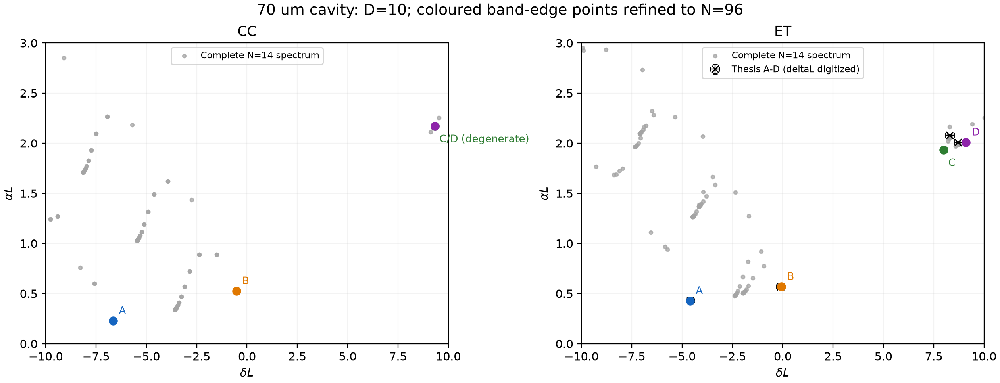
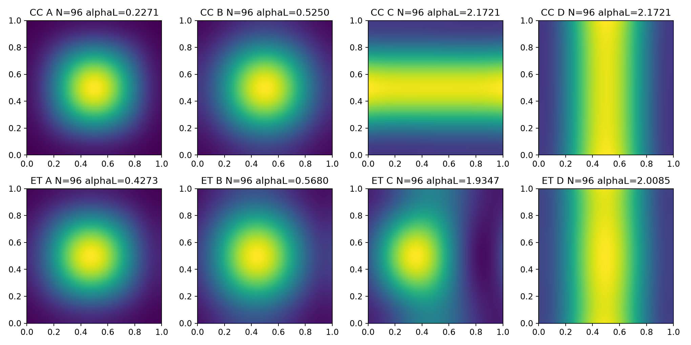
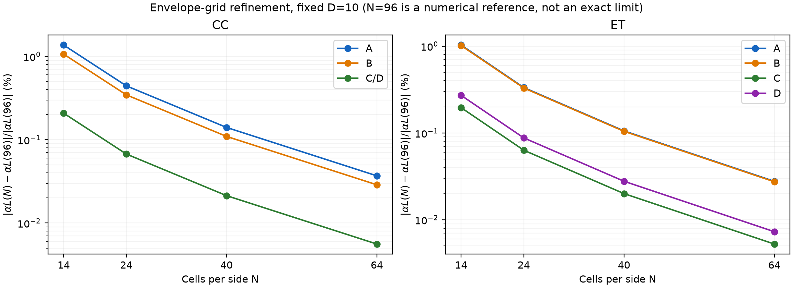
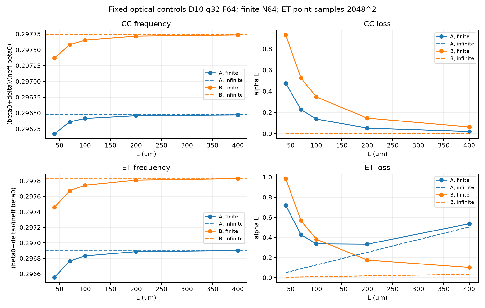

# 梁博士论文数值复现报告 — cwt3d 1.3.0

[下载七页 PDF](liang-reproduction-report.pdf) · [数值对比表](analysis/computed_modes.csv) · [第3章详细报告](analysis/CHAPTER3-REPORT.md)

本页为已发布 cwt3d 1.3.0 的验证记录。仓库保留报告、曲线和标量比较数据；完整复场及独立探针不纳入此文档目录。

## 结论

**可以还原主要趋势和大部分有限尺寸数值，但不能把当前默认模型称为论文所有结果的逐点完全复现。**

- 在论文采用的D=10下，70 µm圆孔/等边三角孔的8个模式阈值中，7个与Table4.2的相对差不超过1.3%；ET-C约低6.98%。[1]
- 第3章三孔FF扫描中，与论文CWT频率曲线基本重合；默认模型的ET/RIT功率辐射损耗相对原文CWT图有约14.5%/17.4%的平均差异（仅统计原图损耗>3 cm⁻¹的点）。论文近似Green的独立实验对照将损耗MAE降至约0.24/0.41 cm⁻¹。[1]
- 同一模式N64→96末步αL最大变化0.0368%，远小于ET-C的偏差；不过D截断仍有可见漂移，不能将横向网格稳定当作全模型收敛。
- L=70/400 µm的边缘功率占比与Table4.3最大相差0.666个百分点；ET的A/B阈值次序随尺寸交换，趋势与论文一致。[1]

## 1. 做了哪些真实计算

第3章按Fig.3.5原样做RIT、FF=.16、D=1–12，并扩展到16/24/32；按Fig.3.6–3.7做CC、ET、RIT三孔、FF=.08到.24的九个点。额外检查纵向积分、Fourier积分和ET采样。共49组默认、39组独立论文近似对照，352个4×4复本征值。

第4章按Table4.1换成九层结构：CC/ET、FF=.16、a=.295 µm。两孔各N14完整784模谱；四带边模沿N14/24/40/64/96延续；A/B在L=40/70/100/200/400 µm计算，400 µm再用N96复核。默认60条模式记录、1568条全谱记录、24条D/q敏感度记录；论文近似对照另有60条模式和1568条全谱。

ET始终是尖端+x的等边三角孔，通过原生SampledPermittivity采样，不是用直角三角孔代替。A–D按模式场和频率身份识别，不是最低损耗四个数值模。CC-C/D简并，只认证二维子空间，不给任意基向量强加独立身份。

## 2. 70 µm的模式阈值：Table4.2

以下是默认模型D10、q32、F64、N96。第4章比较αL；第3章比较功率损耗αr=2α，二者没有混用。[1]

| 孔型 | 模式 | 论文αL | 计算αL | 相对差 |
|---|---|---|---|---|
| CC | A | 0.23 | 0.227058 | -1.28% |
| CC | B | 0.52 | 0.525020 | +0.97% |
| CC | C | 2.18 | 2.172118 | -0.36% |
| CC | D | 2.18 | 2.172118 | -0.36% |
| ET | A | 0.43 | 0.427323 | -0.62% |
| ET | B | 0.57 | 0.568033 | -0.35% |
| ET | C | 2.08 | 1.934732 | -6.98% |
| ET | D | 2.01 | 2.008507 | -0.07% |

论文表格仅印到小数点后两位，±.005只是半末位显示尺度，不是严格仿真误差界。

## 3. δL–αL谱云及ET频移

完整N14谱云与N96模式见下图。ET的δL论文数来自Fig.4.2矢量读图，约±.2；CC没有直接的论文δL参考，不填虚构数。[1]

| ET模式 | 论文δL（约） | 计算δL | 差值 |
|---|---|---|---|
| A | -4.6 ±0.2 | -4.6044 | -0.004 |
| B | -0.1 ±0.2 | -0.0671 | +0.033 |
| C | 8.3 ±0.2 | 7.9969 | -0.303 |
| D | 8.7 ±0.2 | 9.1079 | +0.408 |

A/B的位置接近原图，C/D还有约0.3–0.4的δL差，不能只看部分αL接近就称整张谱云完全一致。

中心单胞图仅由四基本波重构，使用独立全局相位规范，不是包含所有高阶谐波的完整微观场。

## 4. 收敛性

按论文相同D=1–12，频率比辐射损耗更快稳定。扩展D24→32后，默认RIT的A/B辐射损耗仍变化约0.91%/2.93%；D10→12的B模仍约4.53%。原文“D>10收敛良好”没有给严格误差门槛，本次不将其解读为所有量已完全收敛。[1]

N64→96的αL末步最大变化0.0368%；这是离散细化的相邻变化，不是已证明的连续极限误差上界。D24敏感度检查中，CC-A由D10的0.2271变为0.2217（相对论文−3.63%），ET-C仍约−7.11%；不能挑D10恰好贴近表格就宣称全截断已认证。

## 5. 不同孔型和FF

CC的A/B无限结构辐射损耗为零；ET/RIT破坏相应抵消后出现非零辐射。默认全层Green与论文忽略界面反射的近似并不相同，默认损耗与论文CWT图有系统偏差；独立按原文近似构造的control明显接近原图。对照只改变该实验进程的Green工厂，不改安装包、不覆盖默认数据、不拟合参数。[1]

这种改善在第3章很明显，但不能称所有差异都被读图容许覆盖：RIT、FF=.16、D10的control A损耗比原图高0.536 cm⁻¹，超过该图人为设定的±0.410 cm⁻¹读取容许。此容许不是统计置信区间。论文FDTD频率共同点仍有约0.001425 c/a的最大差，不能将与CWT的接近混称与FDTD全面吻合。[1]

第4章也并非所有模式都改善：ET-C从约−6.98%变为−4.93%，CC-C/D反而有约+1.72%偏差。因此Green近似不是所有差异的充分解释，不能据此直接判包有bug或默认模型更准确。

第3章完整逐点比较、默认/近似控制的区别、FF参数化δ–α轨迹，见[详细第3章报告](analysis/CHAPTER3-REPORT.md)。

## 6. 尺寸依赖与边缘功率

L70时ET-A阈值低于B；在本次L100和L200采样点之间发生次序交换，到400 µm时B明显较低。这里只报告采样区间，不杜撰精确交叉长度。有限模频率逐渐趋近无限带边；ET-A的αL先降后升，体现αL的归一化以及辐射/边缘损耗权重变化。

| 孔/模式 | L / µm | 论文边缘占比 | 计算边缘占比 | 差 / 百分点 |
|---|---|---|---|---|
| CC-A | 70 | 67% | 67.354% | +0.354 |
| CC-B | 70 | 69% | 68.627% | -0.373 |
| CC-A | 400 | 26% | 25.767% | -0.233 |
| CC-B | 400 | 26% | 25.924% | -0.076 |
| ET-A | 70 | 58% | 57.334% | -0.666 |
| ET-B | 70 | 71% | 70.533% | -0.467 |
| ET-A | 400 | 2% | 1.806% | -0.194 |
| ET-B | 400 | 19% | 18.679% | -0.321 |

以百分点报告，避免把论文仅写成2%的小数取整误差放大成“9.7%的严重偏差”。原文的整数百分比只提供约半个百分点的显示尺度。[1]

## 7. 独立核查、文件和剩余边界

对默认60个保存的复数场逐一用原始面通量/体积分重算能量平衡，没有把已保存budget当oracle；最大相对闭合差3.21e-13，原始广义本征残差最大1.18e-15，入射边界全部为精确零；harness的7项测试已实际通过。

第3章独立复核检查了49/39条记录、全部438个PDF标记，并用独立TE传输矩阵核查导模；实际重算RIT D1的default/control矩阵，与存档最大差均为零。这是代表性子集重跑，不是全部88组独立重算。此处记录独立复核的范围和结论。

第4章独立复核重新组装全部60个保存向量的原始本征问题并重算通量；另换随机种子求解N96的CC-C和ET-C，|Δλ|L分别约1.45×10⁻¹⁴和0，未发现ET-C/D互换或重复向量。此复核没有重新计算光学耦合，不额外认证历史缓存provenance。

论文PDF数字化值不是作者原始数值；alpha和频率读图容许量、两章参数区别、半空间cladding映射及采样实际FF都在台账里。高D全尺寸扫描、ET几何完全采样收敛尚未完成。

### 仓库内的文件

- [七页中文PDF](liang-reproduction-report.pdf)：实验报告快照。PDF中提到的完整结果ZIP不在此代码仓库中。
- [第3章逐模计算结果](analysis/computed_modes.csv)、[逐点差异](analysis/pointwise_differences.csv)、[截断收敛](analysis/D_convergence.csv)。
- [第4章60条模式记录](finite/modes.csv)、[1568条完整低网格谱](finite/spectrum.csv)、[比较汇总](finite/comparison_summary.json)。
- [原文图形数字化点](digitized/chapter3_reference.csv)与[标定数据](digitized/calibration.json)。这些是图形提取值，不是作者原始数据。

验证使用的数值实现与发布版本1.3.0相同。此次文档整合没有修改数值内核，也没有发布新版本。仓库中已有[70 µm可运行示例](../../examples/liang-70um.md)及[Python API说明](../../api.md)，用于计算结构和修改参数。

## Sources

[1] https://doi.org/10.14989/doctor.k18283 — Yong Liang, Three-dimensional coupled-wave theory for photonic-crystal surface-emitting lasers (doctoral thesis)
