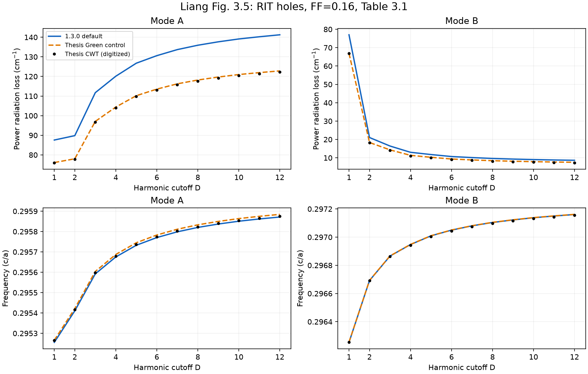
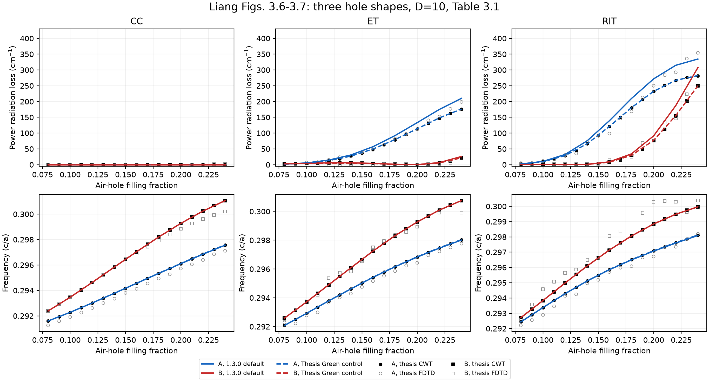
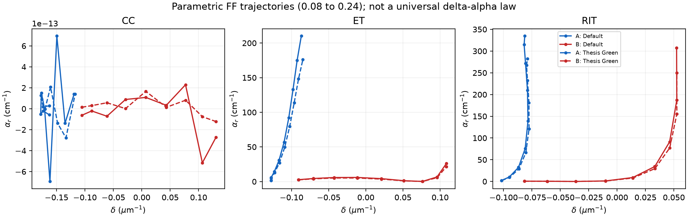

# 梁论文第3章复现：收敛、孔型及损耗

## 结论

1. **频率曲线在原图读图精度范围内基本重合，但这不能替代损耗验证。** 三孔、九个FF点的A/B频率最大相对差为0.00681%。同时计算了A–B带隙，见`bandgap_differences.csv`，避免仅用大的公共频率基线弱化误差。
2. **默认1.3.0对论文CWT辐射损耗有系统偏差。** ET/RIT的平均相对差见下表；这不是小本征残差能消除的差异。
3. **论文Green近似的独立对照明显接近原图。** 该对照显式使用原文Eq.(3.19)/(3.23)忽略层间反射的PC局部核；不是默认1.3.0的另一条内置开关，也没有把它当作默认结果或调参拟合。[1]
4. **高阶截断仍是主要数值误差来源。** D=10→12并非严格不变；D=24→32时低损耗B模还变化约2.93%。因此不将D=32宣称为完全收敛。

## 来源及定义

按论文Fig.3.5原样使用RIT、FF=.16、D=1–12；扩展到16/24/32作额外检查。孔型/FF扫描对应Fig.3.6–3.7：CC圆孔、ET等边三角孔（尖端+x）、RIT直角等腰三角孔，FF=.08,.10,…,.24，D=10；结构均为Table3.1，a=.295 µm，背景ε=12.7449，空气ε=1。[1]

- 本征值定义为λ=δ+iα。第3章论文比较的是**功率损耗αr=2α**，由µm⁻¹换到cm⁻¹乘10⁴。
- 频率采用论文线性换算 `(β0+δ)/(neff β0)`，`neff=β0/k0`，不是重新求解每个模式的完整频率色散。[1]
- A/B按频率从低到高编号，不是按损耗排序。所有四个复本征值及向量均保存。
- 本次读取438个原PDF矢量标记坐标；**它们是图形数字化，不是作者原始数值数据**。CWT实心标记与FDTD空心标记分开。独立文献台账采用保守读图容许量：Fig.3.5约±2 cm⁻¹，Fig.3.6约±3 cm⁻¹，频率约±(2–3)×10⁻⁵；`calibration.json`另保留标记中心±.25 PDF点的位置误差，不把它当作原作者仿真不确定度。
- CC的A/B零辐射损耗采用原文明确的零，不把图形中约.15 cm⁻¹的绘图偏置当作物理损耗。[1]

## FF=.16的辐射损耗切片

单位均为cm⁻¹；原图值约±3 cm⁻¹。由于小损耗B模读图分辨率有限，其百分比只作为诊断量。

| 孔型 | 模式 | 论文CWT图 | 默认1.3.0 | 论文近似独立对照 | 默认相对差 |
|---|---|---:|---:|---:|---:|
| CC | A | 0.00 | -0.00 | -0.00 | 约零，使用绝对差 |
| CC | B | 0.00 | 0.00 | 0.00 | 约零，使用绝对差 |
| ET | A | 49.16 | 56.93 | 49.58 | 15.8% |
| ET | B | 3.89 | 4.21 | 3.57 | 8.3% |
| RIT | A | 120.43 | 139.12 | 120.98 | 15.5% |
| RIT | B | 7.62 | 9.05 | 7.91 | 18.7% |

## 三孔、九个FF点的误差汇总

每孔A/B共18点；损耗相对差仅统计原图|αr|>3 cm⁻¹的点，近零点一律使用绝对差，不能除以零。

| 孔型 | 默认频率最大相对差 | 默认损耗MAE / cm⁻¹ | 默认损耗平均相对差 | 论文近似对照损耗MAE / cm⁻¹ |
|---|---:|---:|---:|---:|
| CC | 0.00327% | 0.000 | 不适用（零损耗） | 0.000 |
| ET | 0.00616% | 6.452 | 14.50% | 0.242 |
| RIT | 0.00681% | 17.631 | 17.40% | 0.413 |

`pointwise_differences.csv`同时列出对论文FDTD图点的差值。不同FF下这种差值并不一致；**不据“含层间反射”这个机制就宣称默认结果一定更接近真实Maxwell解**。论文FDTD点本身有有限空间离散误差，且本次没有重跑FDTD。

## 截断收敛：默认1.3.0

以下相对变化以较大D结果作分母；频率变化为c/a单位的绝对值。原文说D大于10时收敛良好，但没有给出严格1%门槛。[1]

| D变化 | C矩阵相对变化 | A损耗相对变化 | B损耗相对变化 | A频率绝对变化 | B频率绝对变化 |
|---|---:|---:|---:|---:|---:|
| 10→12 | 1.225% | 1.507% | 4.533% | 2.06e-05 | 2.28e-05 |
| 12→16 | 1.538% | 1.848% | 5.847% | 2.61e-05 | 2.91e-05 |
| 16→24 | 1.553% | 1.833% | 5.876% | 2.66e-05 | 2.99e-05 |
| 24→32 | 0.781% | 0.907% | 2.928% | 1.34e-05 | 1.52e-05 |
| 10→32 | 5.037% | 5.960% | 20.576% | 8.67e-05 | 9.71e-05 |

纵向积分q=24/48/72/96和RIT Fourier积分F=48/96/144在D=12的检查均已实际执行，矩阵差远小于本次D截断变化。此结论限于所测试结构及D，不能外推到所有参数。

ET采用1.3.0原生`SampledPermittivity`，没有用RIT替代。采样512/1024/2048做了独立检查：2048相对1024矩阵变化0.409%，A辐射损耗变化0.463 cm⁻¹；实际FF有网格离散偏差，逐行记录于JSONL。ET的亚cm⁻¹差异不能解释成高精度几何认证。

## 实际计算与复跑

默认模型49组，论文近似对照39组，合计352个4×4本征值；最大归一化本征残差8.4e-16，最大Bragg参考根相对失配1.67e-16。这些是代数和参考根精度，不是模型误差界。

本仓库归档本次验证的曲线和标量比较数据，不包含完整实验工作区的扫描脚本与复场。计算接口及单个结构的可执行示例见[Python API](../../../api.md)和[70 µm示例](../../../examples/liang-70um.md)。

数字化CSV和标定见上一层的 `digitized/` 目录。原论文PDF不包含在仓库内，来源见文末DOI。

### 图

第三张图是本次派生图，横轴δ，FF是扫描参数；它不是把论文另一张图改名，也不是所有结构通用的δ–α定律。

## Sources

[1] https://doi.org/10.14989/doctor.k18283 — Yong Liang, Three-dimensional coupled-wave theory for photonic-crystal surface-emitting lasers (doctoral thesis)
